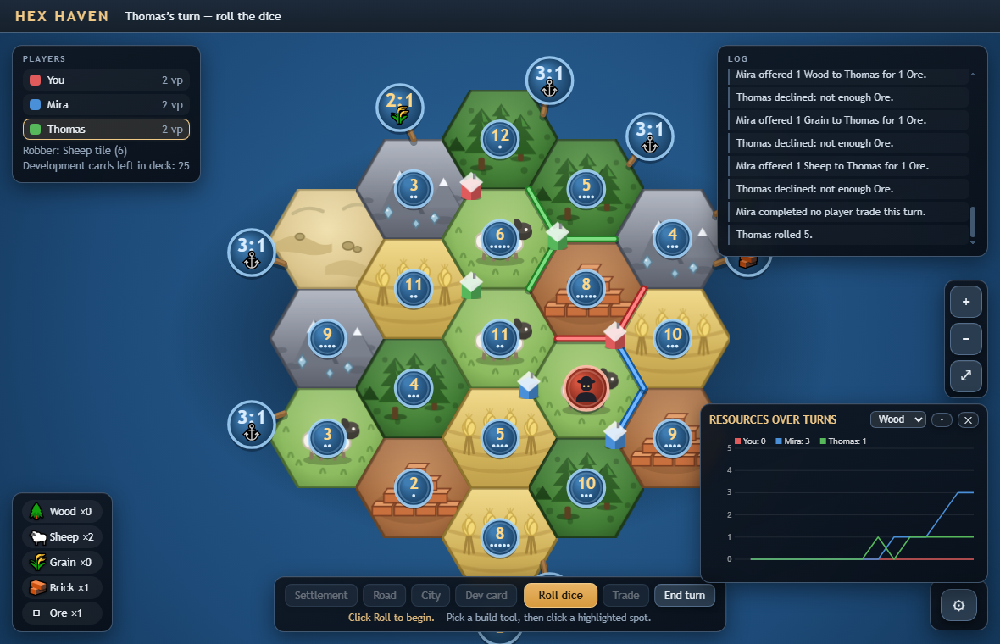

# Hex Haven

A browser-based, Catan-style hex island game in plain JavaScript — single
HTML page, no build step, no dependencies.



## Play online

The game is hosted by GitHub Pages (auto-deployed from `master` by
`.github/workflows/deploy.yml`):

**https://tomlogan501.github.io/hexhaven/**

## Play locally

Open `index.html` in a browser, or serve the folder statically.

## Tests

Continuous integration runs all three suites on every push
(`.github/workflows/ci.yml`). Locally:

```
node tools/check.js    # board topology, tokens, harbors
node tools/game-test.js    # rules engine
node tools/dom-test.js     # full turn flow in a headless DOM
```

## Documentation

- `rules.md` — Catan rules → implementation mapping, with a deviation list
- `CHANGELOG.md` — every fix and feature with commit hashes

## Legal

Unofficial fan implementation. **CATAN®** is a trademark of Catan GmbH; this
project is not affiliated with, endorsed by, or sponsored by Catan GmbH.

## License

[MIT](LICENSE) © 2026 Thomas SIMON
