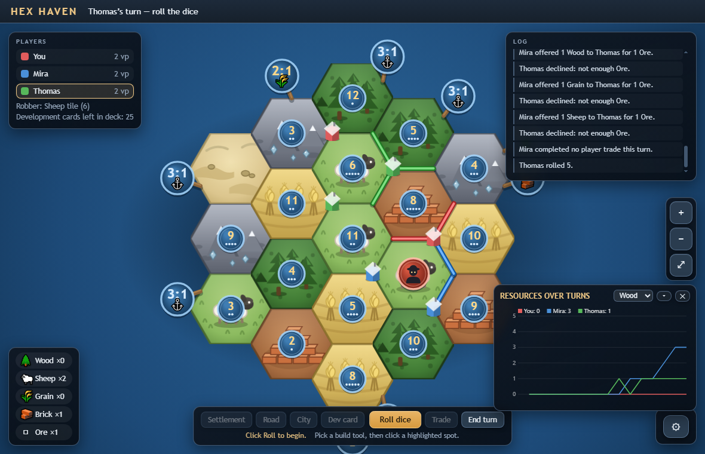

# Hex Haven

A browser-based, Catan-style hex island game in plain JavaScript — single
HTML page, no build step, no dependencies.



## Play online

The game is hosted by GitHub Pages (auto-deployed from `master` by
`.github/workflows/deploy.yml`):

**https://tomlogan501.github.io/hexhaven/**

<!-- coderabbit-ai-generated:v1 -->

<!-- coderabbit-ai-generated-section:v1:68ecad36da77bb36bc898a17e61f7f755cbf10a60f14fe9a91bbdb40025318db -->

<!-- coderabbit-ai-generated:v1 -->

<!-- coderabbit-ai-generated-section:v1:e0bc8bb7b1c367440f9ae23b43269534e322188b176304331b89396971532738 -->

## Play locally

Open `index.html` in a browser, or serve the folder statically.

For 2–4 people on one device, select **Pass and play**, choose the number of opponents, and select **New game**. Pass the device when prompted; each player can see their own hand, make trades, and choose cards to discard. The default mode remains a solo game against AI.

## Multiplayer over the internet

Run the room service with Node 18 or newer:

```sh
node server/index.js
```

<!-- coderabbit-ai-generated:v1 -->

<!-- coderabbit-ai-generated-section:v1:f65aa8f1fa803cbaf3efd989e59f06232f337cbbd6a8f4611ff67d53a606a67f -->

It serves the game and room API on port 3000, or the port in `PORT`. For remote play, host this service at an HTTPS address reachable by all players. Open that address, choose **Online multiplayer**, enter a name, and create a room. Share the six-character code and server address; the other players join with their own names. The host starts when 2–4 players have joined. Players can reload their tab, or rejoin on the same browser using the same server, room code, and name. Reconnection credentials are stored in that browser.

The GitHub Pages site has no room service of its own. To play there, enter the HTTPS room service address in **Room server** before creating or joining a room. The room service keeps games in memory: restarting it clears rooms, and inactive rooms expire after 12 hours. A running tab keeps its room active.

<!-- /coderabbit-ai-generated:v1 -->

Run `node tools/online-test.js` to check the room API and online game controller.

<!-- /coderabbit-ai-generated:v1 -->

<!-- /coderabbit-ai-generated:v1 -->

## Tests

<!-- coderabbit-ai-generated:v1 -->

<!-- coderabbit-ai-generated-section:v1:c3320e68427dfec3da373e99783e309bbb9b37da1ae3c73ef83fc5bd5d771d70 -->

Continuous integration runs the checks below and the online room tests on every push and pull request. Locally:

<!-- /coderabbit-ai-generated:v1 -->

```
node tools/check.js    # board topology, tokens, harbors
node tools/game-test.js    # rules engine
node tools/dom-test.js     # full turn flow in a headless DOM
```

## Documentation

- `rules.md` — Catan rules → implementation mapping, with a deviation list
- `CHANGELOG.md` — every fix and feature with commit hashes

## Legal

Unofficial fan implementation. **CATAN®** is a trademark of Catan GmbH; this
project is not affiliated with, endorsed by, or sponsored by Catan GmbH.

## License

[MIT](LICENSE) © 2026 Thomas SIMON
